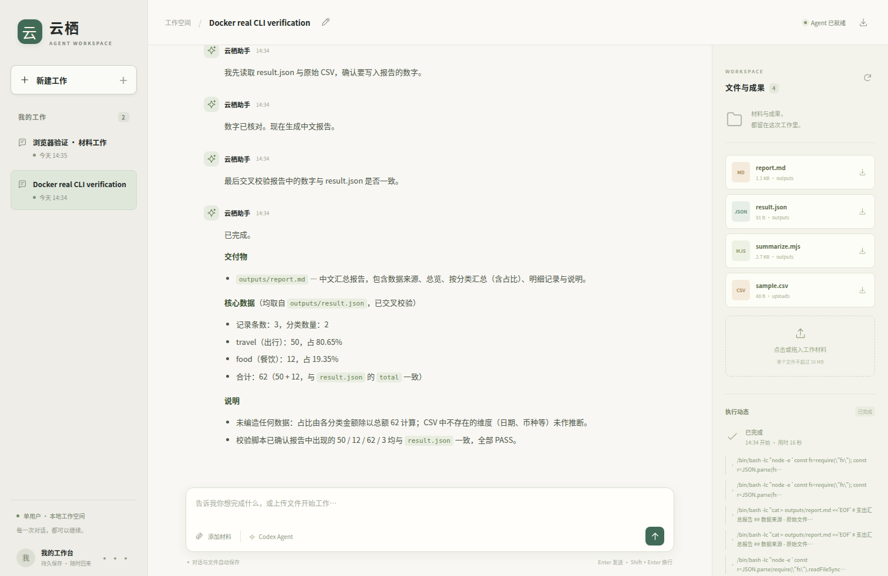

# 云端 Agent 助手工作台

[](https://github.com/ssddxg/cloud-agent-workbench-exam-20261117/actions)

把真实 **Codex CLI 0.157.1** 带到浏览器：创建工作会话，上传材料，观察工具执行，预览和下载成果，再通过后续消息继续同一项工作。单用户运行，无需把服务部署到公网。



本次交付已完成真实验证：**22 项自动测试通过**；[Docker 构建、真实 CLI 执行及浏览器检查通过](https://github.com/ssddxg/cloud-agent-workbench-exam-20261117/actions/runs/44104352812)。两类任务各自完成后续修改，费用工具实际结果为总额 **280**、交通过滤 **50**。运行记录、产物和截图见 [验证证据](evidence/README.md)。

后端和前端均无 npm 应用依赖。Agent 的命令执行、文件修改与对话恢复由 Codex CLI 完成，工作台负责会话、调度、持久化、浏览器交互和模型协议适配。应用并非仅调用模型后展示聊天文本。

## 快速启动：Docker

需要 Docker Engine/Desktop 与 Docker Compose，以及可用模型服务。首次构建需要下载基础镜像、Codex CLI 和系统工具；之后启动复用镜像。

```bash
cp .env.example .env
# 编辑 .env，至少填写下面四项
# AGENT_API_KEY=你的服务端凭据
# AGENT_BASE_URL=https://你的模型服务/v1
# AGENT_MODEL=你的可用模型名称
# AGENT_PROTOCOL=chat
docker compose up --build -d
```

打开 **http://localhost:3210**。检查服务和日志：

```bash
docker compose ps
docker compose logs --tail=100 workbench
curl http://localhost:3210/api/health
```

`configured: true` 表示服务端已配置凭据，`cliAvailable: true` 表示已找到 CLI；这两个值不代表凭据已通过模型服务认证，实际发送任务才会联调模型。界面也会显示配置状态。

修改 `.env` 后执行 `docker compose up -d --force-recreate`。停止服务使用 `docker compose down`，保留持久卷中的会话和文件；`docker compose down -v` 会删除这些数据。

Windows PowerShell 可用 `Copy-Item .env.example .env` 替代 `cp`。不要在命令或截图中展示真实密钥。

## 配置

| 配置项 | 含义与默认值 |
| --- | --- |
| `AGENT_API_KEY` | 必填；仅由服务端访问，不返回给浏览器 |
| `AGENT_BASE_URL` | 模型 API 的基础地址，包含 `/v1` 或平台要求的前缀；不包含 `/chat/completions` 或 `/responses` |
| `AGENT_MODEL` | 服务实际提供的模型名；默认 `gpt-5.1-codex-mini`，兼容平台必须改成其模型名 |
| `AGENT_PROTOCOL` | `chat`：Chat Completions 兼容适配；`responses`：原生 Responses 转发 |
| `MAX_CONCURRENT_RUNS` | 跨会话并发上限，默认 2，可设 1–4；其余任务排队，队列最多 20 个 |
| `RUN_TIMEOUT_MS` | 单次执行超时，默认 600000 毫秒 |
| `DATA_DIR` | 默认项目的 `data/`；容器固定 `/app/data` |
| `HOST` / `PORT` | 本地默认 `127.0.0.1:3210`；容器内部使用 `0.0.0.0:3210`，Compose 仅发布到宿主机回环地址 |
| `CODEX_BIN` | 非标准安装时指定 Codex 原生可执行文件或 `bin/codex.js`；容器已固定 |

`.env`、`data/`、用户材料与 CLI 会话记录已被 Git 忽略，Docker 构建也排除了 `.env` 和数据目录。公开仓库只应包含 `.env.example` 和不含凭据的演示证据。临时平台凭据过期后，需要换成自己的有效配置。

### 模型服务兼容

Codex CLI 使用 Responses API。`chat` 模式在服务端将 Responses 消息、函数工具和自定义 `apply_patch` 工具转换成 Chat Completions 请求，并把返回的工具调用和文本封装为 Responses SSE 事件，供 CLI 继续执行真实工具。兼容服务必须支持 **tools/function calling**；只支持普通文字聊天的接口不足以运行 Agent。

`responses` 模式保留原生 Responses 流，适合完整兼容该协议的服务。`chat` 模式每个模型请求等待完整 Chat 响应后再转换，界面能实时显示 CLI 事件，但不承诺逐 token 的模型文字显示。原生 provider reasoning 私有状态不会跨协议转发；工具调用、输出和普通消息会保留。

上游请求设有超时，CLI 自动重试次数为 0，避免错误凭据或不兼容接口反复消耗时间和额度。认证、额度、超时或 CLI 错误会使任务进入可见失败状态；修改配置后重启，再发送消息继续。

## 使用流程

1. 新建一个会话，输入任务。每个会话拥有独立的工作目录和 Codex thread ID。
2. 可先上传材料；文件落在该会话 `uploads/` 下。同名上传不覆盖已有文件，执行期间不允许上传，避免与 Agent 同时修改。
3. 发送任务后可查看排队、执行、工具命令和完成状态；长任务可以停止。建议要求 Agent 将成果写到 `outputs/`。
4. 在右侧文件区预览文本或下载成果。HTML 与其他代码作为文本预览，不在应用源域内执行；二进制与大文件请下载后打开。
5. 发送修改意见，工作台通过 `codex exec resume <threadId>` 继续原会话。已有文件、上下文与 CLI 线程都保留。
6. 切换到另一会话，可同时处理不同任务。关闭或刷新浏览器不会取消服务端任务；再次打开可恢复会话和事件记录。

限制：单文件上传最多 **10 MB**；文本预览最多 **512 KB**；单条消息最多 **32000 字符**。上传接口接受任意文件，但能否理解其内容取决于 CLI 工具；默认镜像具备 Node.js、Python3 和 Git，不包含 OCR、Office 或 PDF 解析库。演示使用 CSV 和 Markdown，无需下载额外依赖。

## 演示与验证

见 [演示步骤](demo/README.md)。应用运行且模型配置有效后：

```bash
npm run demo
```

这个脚本通过应用的真实 HTTP 接口创建两项工作并上传合成材料，实际调用 Codex CLI：

- **代码开发**：生成零依赖 Node.js 费用汇总工具，执行并保存结果；继续交流，增加按类别过滤并验证交通支出为 50。
- **日常工作**：读取项目会议纪要，输出周报和待办 CSV；继续交流，补充优先级和管理摘要。
- 两个会话分别执行初次任务和后续任务，检查独立 CLI thread ID、成功的真实命令、持久消息和可下载文件。

脚本把实际运行证据写入 `evidence/verification.json`，详细消息、工具事件与成果分别写入 `evidence/code-task/`、`evidence/daily-task/`。这些演示材料均为合成数据。重新运行会创建新会话并产生实际模型费用。

本次具体执行结果以仓库 `evidence/` 中的文件和 [GitHub Actions](https://github.com/ssddxg/cloud-agent-workbench-exam-20261117/actions) 实际记录为准。不要把模板、配置或健康检查当成完整 Agent 执行成功的证据。

自动测试无需模型或有效凭据：

```bash
npm test
```

测试覆盖存储恢复、路径和链接防护、协议工具调用转换，以及 HTTP、CLI 进程生命周期、排队取消、SSE、恢复与错误脱敏。部分集成测试使用可控的测试 CLI；实际 CLI 联调由上述演示和 CI 中可选的真实 Agent smoke test 单独证明。

仓库工作流会运行测试、构建实际 Docker 镜像、校验固定 CLI 版本并启动容器，再通过真实 Chrome 验证上传、预览、下载、刷新恢复和移动布局。配置仓库 secret `AGENT_API_KEY` 和 variables `AGENT_BASE_URL`、`AGENT_MODEL`、`AGENT_PROTOCOL` 后，在 Actions 中手动运行工作流还会执行 `demo/docker-smoke.js`，使用真实 Agent 并上传 `docker-verification` artifact。普通 push 不调用模型，避免重复消耗额度。构建步骤不接收模型密钥，真实 Agent 运行时才注入环境变量。浏览器测试依赖只在 CI 临时目录安装，不是应用运行依赖。

## 现有环境快速运行

已有 **Node.js 22+** 和 **Codex CLI 0.157.1** 时，可不安装应用依赖直接运行：

```bash
cp .env.example .env
# 填写模型配置后
npm start
```

如果未找到 CLI，设置 `CODEX_BIN`；例如 Linux 全局 npm 安装通常为 `/usr/local/lib/node_modules/@openai/codex/bin/codex.js`。原生运行主要用于快速联调，正式复现推荐 Docker。

## 结构与关键取舍

```text
public/                 浏览器界面，无第三方前端依赖
src/server.js           HTTP、上传下载、预览、SSE 与请求防护
src/runner.js           真实 Codex 子进程、resume、队列、停止、超时
src/store.js            会话 JSON 原子替换、追加事件日志、文件路径检查
src/bridge.js           服务端模型协议适配与上游错误处理
data/sessions/<id>/     session.json、events.jsonl、workspace/{uploads,outputs}
data/agent-home/        应用专用 Codex 会话数据，不使用个人 Codex 配置
demo/                   演示脚本和合成输入
test/                   无外部模型依赖的自动化测试
evidence/               可公开复核的实际演示结果
```

采用单进程文件存储，减少两小时交付的环境成本。每次会话状态写入临时文件后原子替换，事件逐条追加；启动时将未完成任务标记为 `interrupted`，保留已生成文件和消息，用户可继续交流。SSE 连接断开不会影响执行，重连可按事件 ID 补发；浏览器切换与刷新后也能重读持久数据。单会话只允许一个任务运行，跨会话有限并发。

Agent 子进程只继承运行工具所需的环境和临时内部 bridge token，不直接获得上游模型密钥。浏览器文件接口拒绝路径穿越、隐藏路径和符号链接；界面展示的内容作为文本处理。Host/Origin 检查用于阻止外站直接控制 localhost 服务。

## 已知限制

- **仅供可信单用户使用。** 会话工作目录提供逻辑分离，不是恶意代码的安全边界。Codex 在非交互执行中允许命令，容器中的任务可访问该进程权限允许的文件；不同会话不具备独立容器或内核沙箱。不要上传敏感材料或执行不可信代码，也不要把此服务直接暴露到公网。
- Docker 以非 root 用户运行，Compose 限制端口、进程和资源，但这些措施不能替代真正的任务隔离。默认不挂载宿主机源码、SSH 密钥或 Docker socket。原生启动时 Agent 具有宿主机当前用户权限，应仅用于可信任务。
- 服务没有登录、多用户权限、协作编辑和公网部署配置；文件存储也不支持多副本并发写入。
- 服务重启会中断正在执行的任务；可以恢复对话和成果，但不会自动重放命令，避免重复副作用。失败、停止与超时后保留已有文件，不保证回滚部分修改。
- 当前无磁盘配额或自动清理策略，事件历史和成果持续保存。文件列表最多遍历 1000 项、12 层目录，隐藏文件和依赖缓存不会展示。请定期备份和清理持久卷。
- 首次 Docker 构建需要网络。模型质量、工具调用兼容性、延迟和额度由所配服务决定，不能保证所有模型或任意长任务均能完成。
