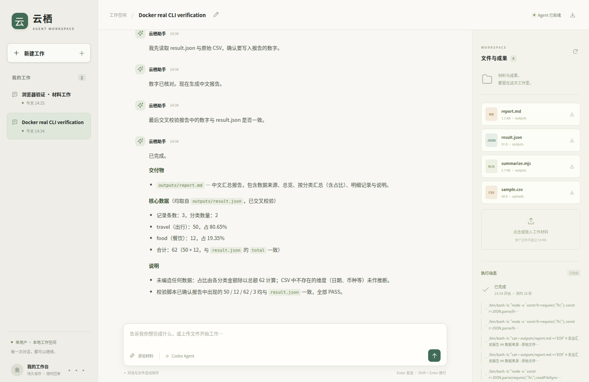

# 实际运行证据

本目录包含应用真实调用 Agent 后生成的结果。模型使用平台提供的 `linext-5.3-luna`，真实 CLI 为 `Codex 0.157.1`；临时凭据未包含在证据或源码中。时间均可在 JSON 的 ISO 时间戳中复核。

| 验收项 | 结果与证据 |
| --- | --- |
| Docker 构建、启动、真实 CLI | [最终成功验证](https://github.com/ssddxg/cloud-agent-workbench-exam-20261117/actions/runs/44104352812)，容器内完成上传、生成脚本、执行和续聊；详见 [docker-smoke.json](docker-smoke.json) |
| 代码开发与后续修改 | [代码任务完整消息及命令](code-task/session.json)，[实际工具源码](code-task/outputs/expense-summary.mjs)、[总额 280](code-task/outputs/result.json)、[交通过滤总额 50](code-task/outputs/transport-result.json) |
| 日常工作与后续交流 | [材料任务完整消息及命令](daily-task/session.json)，[项目周报](daily-task/outputs/weekly-report.md)、[待办表](daily-task/outputs/action-items.csv)、[管理摘要](daily-task/outputs/executive-summary.md) |
| 多会话、真实 resume | [verification.json](verification.json)：两个独立 CLI thread ID，每个会话两次 completed 执行；追加请求使用原 thread ID |
| 浏览器操作与界面 | [browser-verification.json](browser-verification.json)：真实 Chrome 检查新建、重命名、上传、安全预览、下载、刷新恢复、多会话、手机布局及真实 CLI 成果可见；JavaScript 错误为 0 |
| 状态恢复与异常 | 自动化测试覆盖停止、排队、服务重启中断、会话和文件持久化、SSE重放、路径/符号链接与错误脱敏。集成测试中的 fake CLI 仅用于确定性回归，与上述真实运行证据明确分开 |

两类工作最初在现有 Windows 环境中并行执行（北京时间 2026-11-17 22:13–22:19），没有安装额外应用依赖。Docker 中首次真实运行于 22:24 完成，最终自动测试、容器与浏览器验证于 22:35 完成。服务重启后，这些会话、消息与文件仍保存在应用的 `data/` 持久目录；公开仓库中的 JSON 是允许复核的合成演示快照，不会被当作新用户的实时会话载入。CI 截图显示的是测试浏览器所在的 UTC 时间。



其他截图：[初始界面](screenshots/01-workspace.png)、[材料预览](screenshots/02-material-preview.png)、[报告成果](screenshots/04-report-preview.png)、[手机布局](screenshots/05-mobile.png)。

下载仓库后，可在不调用模型的情况下复核生成工具：

```bash
node evidence/code-task/outputs/expense-summary.mjs demo/expenses.csv --json
node evidence/code-task/outputs/expense-summary.mjs demo/expenses.csv --category 交通 --json
```

预期分别为总额 `280` 与 `50`。重新执行整个真实 Agent 流程见 [演示说明](../demo/README.md)，会创建新会话并消耗模型额度。
